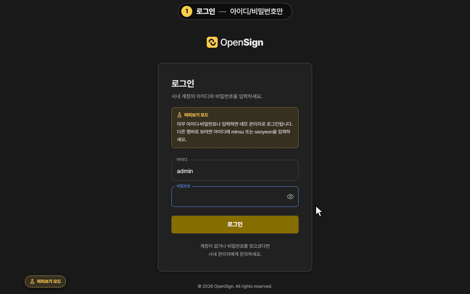

<p align="center">
  <picture>
    <source media="(prefers-color-scheme: dark)" srcset="public/brand/opensign-logo-dark.svg">
    
  </picture>
</p>

<h3 align="center">From signing request to completed PDF and audit-trail certificate —<br>an open-source e-signature app for your team</h3>

<p align="center">
  <a href="LICENSE"></a>
  
  
  
  
  
  <a href="https://github.com/abitocodes/opensign/pulls"></a>
</p>

<p align="center">
  <a href="README.md">한국어</a> · <b>English</b>
</p>

<p align="center">
  
</p>

> The product UI is in Korean. This page is the English companion of [README.md](README.md).

## Table of contents

- [About](#about)
- [Features](#features)
- [Try it in one minute](#try-it-in-one-minute)
- [Architecture](#architecture)
- [Signing flow](#signing-flow)
- [Document lifecycle](#document-lifecycle)
- [Tech stack](#tech-stack)
- [Local development](#local-development)
- [Environment variables](#environment-variables)
- [Deployment](#deployment)
- [Project layout](#project-layout)
- [Scripts and tests](#scripts-and-tests)
- [Security](#security)
- [Known limitations](#known-limitations)
- [Contributing](#contributing)
- [License](#license)

## About

OpenSign is an **e-signature web app for use inside a team**. Employees sign in with an ID and password, upload documents and request signatures. External signers need no account: they open the link from the e-mail, verify their identity and sign. When everyone has signed, OpenSign builds the **completed PDF** and a separate **audit-trail certificate** (PDF) and e-mails them to the participants.

- **Admins create the accounts.** There is no public sign-up and no social login.
- **External signers never log in.** They arrive through the e-mail link and pass an e-mail identity check (optional password, limited attempts).
- **No plans, billing or usage quotas.** It runs on the Supabase project you operate yourself.
- **Every step leaves an audit trail.** Created / sent / viewed / signed / rejected / cancelled events are recorded with IP address and user agent, and the completed PDF gets a SHA-256 fingerprint.
- **You can try it without any backend.** `npm run dev:preview` lets you click through every screen on fake data.

## Features

| Area | What you get |
|---|---|
| Requesting | Upload (PDF or images, several files merged) → participants (sequential or parallel, sign or view-only) → place fields (signature/stamp, text, checkbox, date, dropdown, transcribe, image) → request details (deadline, lock, attachments, CC, labels) → send now or schedule |
| Signer screen | Identity check → preview → fill in fields (draw / typed / uploaded signature, stamp maker) → consent → done, or reject |
| Completion | Completed PDF with all values merged + audit-trail certificate, SHA-256 fingerprint of the result, completion e-mail with both PDFs attached |
| Document management | Inbox with status filters, search, sorting, progress info, reminders, cancel, labels, hide, download and CSV export; home dashboard |
| Recurring work | Templates, bulk send, link signing, internal approvals and approval lines, custom fields, address book, document editor, form builder |
| Administration | Workspace settings: basic info, members (create accounts, roles, password reset), groups, audit log, personal settings |

## Try it in one minute

No Docker, no Supabase account, no mail server — just Node.js 20.9 or newer.

```bash
git clone https://github.com/abitocodes/opensign.git
cd opensign
npm install
npm run dev:preview        # http://localhost:3100
```

An **in-memory mock backend** replaces authentication, database, storage and mail. It reads the schema from `supabase/migrations` (defaults, NOT NULL, CHECK, UNIQUE, foreign keys) and applies the same rules, and it starts with fictional demo data ("(샘플)" documents, templates, contacts, approvals).

- **Login**: any ID and password signs you in as the demo admin. The IDs `minsu` and `seoyeon` sign you in as those members.
- **Mail**: nothing is sent; mails are only logged to `/dev/mailbox`. Signing requests, reminders and completion mails still "go out" on screen.
- **Reset**: restart the server, or use "데모 데이터 초기화" in the "미리보기 모드" badge at the bottom left.

<p align="center">
  
</p>

Preview-only buttons (dashed yellow outline) let you walk the whole flow without a real signer:

| Where | Button | What it does |
|---|---|---|
| Bottom left of every screen (top left on phones) | "미리보기 모드" badge | Open the mailbox, reset demo data, open the signer page of a document waiting for signatures |
| Sent screen · inbox row · document viewer | "○○ 서명자 화면 열기" (open the signer page) | Opens that participant's signing page (`/sign/…`) in a new tab, no e-mail needed |
| Same (requester / admins) | "모든 서명자 서명 완료 처리 (미리보기)" (mark all signers as signed) | Signs for every signer in turn with dummy values, through the same server-side steps as a real signature (completed PDF, certificate, completion mails) |
| Signer identity check | "본인 확인 건너뛰기 (미리보기)" (skip the identity check) | Runs the check with the invited e-mail (and password) |
| Signer signing screen | "자동 입력 (미리보기)" (auto-fill) | Fills all your fields with dummy values |

These buttons and the mock backend exist **only in the dev server** (`NEXT_PUBLIC_PREVIEW_MODE=1` and `NODE_ENV` not `production`, see [`src/lib/preview/flag.ts`](src/lib/preview/flag.ts)). In `npm run build` output and in a normal `npm run dev`, `next.config.ts` swaps the preview UI and the mock backend's browser client for inert stand-ins, so none of it is bundled, and `/api/preview/*` answers 404. Design notes: [`src/lib/preview/DESIGN.md`](src/lib/preview/DESIGN.md).

## Architecture

<p align="center">
  
</p>

- **`src/proxy.ts`** refreshes the session on every request and guards the app. The only public paths are `/login`, `/sign/`, `/link/` and `/api/sign/`.
- **There are two kinds of Supabase client.** The default is the RLS client bound to the signed-in user's session (`lib/supabase/server.ts`). The service-role admin client (`lib/supabase/admin.ts`) is used only by server code that has **already authorised the caller another way**: signer-token flows, member account management, and mail / audit logging.
- **Files go from the browser straight to Storage**, into the private `documents` bucket, authorised by workspace membership (RLS). The server always rebuilds storage paths from ids.
- **Server code**: `lib/server/send.ts` (send now / scheduled, deadline expiry), `lib/pdf/finalize.ts` (completed PDF, certificate, SHA-256), `lib/email` (mailer and templates), `lib/events.ts` (audit trail).
- **Mail**: every mail is also written to the `outbound_emails` table. Without SMTP configured, it is only logged.

## Signing flow

<p align="center">
  
</p>

1. **Prepare** — the requester uploads the document (Storage), chooses participants and fields, and fills in the request details (deadline, CC, labels).
2. **Send** — `sendDocument` issues a fresh signing token per participant and sends the signing-request mail: to the first signer only for sequential requests, to everyone at once for parallel ones.
3. **Sign** — the signer opens `/sign/[token]` from the mail, passes the e-mail identity check (optional password, lock-out after failures), fills in the fields, consents and signs. The `sign_submit` RPC processes it atomically with a row lock; rejecting goes through `sign_reject`. Sequential requests then mail the next signer.
4. **Complete** — after the last participant, the server builds the completed PDF and the audit-trail certificate, records the SHA-256, and e-mails both PDFs to the requester, the CC list and every participant.

## Document lifecycle

<p align="center">
  
</p>

| `documents.status` | Shown in the inbox as | When it changes |
|---|---|---|
| `draft` | 작성 중 (draft) | Right after upload; a scheduled send that fails validation also returns here |
| `scheduled` | 예약 (scheduled) | Scheduled send is set (`scheduleSend`); `dispatchScheduled` sends it once the time has passed |
| `in_progress` | 내/상대 서명 필요, 내/상대 열람 필요 (my/their turn to sign or view) | Sent by `sendDocument`; the badge depends on who is looking |
| `completed` | 완료 · 열람 완료 (completed) | The last participant has signed (or viewed) |
| `rejected` | 서명 거절 (rejected) | A signer rejects (`sign_reject`) |
| `signing_cancelled` | 서명 취소 (signing cancelled) | The signing deadline passes (`expireOverdue`) |
| `request_cancelled` | 요청 취소 (request cancelled) | The requester or an admin cancels (`doc_cancel_request`) |
| `on_modifying` | 수정 중 (being modified) | The content is being edited (`doc_start_modify`); sending again issues new signing tokens |

## Tech stack

| Area | Technology |
|---|---|
| Framework | Next.js 16 (App Router, Turbopack, `proxy.ts`) · React 19 |
| Language / styling | TypeScript 5 · Tailwind CSS v4 (CSS-first config, design tokens) |
| Backend | Supabase — Auth (ID/password) · Postgres (RLS, RPC) · Storage (private bucket) |
| PDF | pdf.js (viewer) · pdf-lib + fontkit (completed PDF, certificate) |
| Mail | nodemailer (SMTP; only logged when unset) |
| UI | lucide-react · sonner · Pretendard font |
| Tests | playwright-core (system Chrome) E2E · mock-backend self-test |
| Hosting | Vercel or a Node server |

## Local development

Requirements: Node.js 20.9+, Docker Desktop (for the local Supabase stack).

```bash
git clone https://github.com/abitocodes/opensign.git
cd opensign
npm install
npx supabase start          # local Supabase: API :54321 · Studio :54323 · Mailpit :54324
cp .env.example .env.local  # fill in from `npx supabase status` (SMTP_HOST=127.0.0.1, SMTP_PORT=54325)
npm run db:reset            # apply migrations + create test accounts
npm run dev                 # http://localhost:3000
```

- Local test accounts (development only): `admin` / `Admin1234!`, `minsu` / `Test1234!`, `seoyeon` / `Test1234!`
- Mails sent locally show up in Mailpit (http://127.0.0.1:54324) and in `/dev/mailbox`.
- `npm run seed` creates accounts with well-known passwords, so it **refuses to run against a non-local Supabase URL**. To use another env file: `node scripts/seed.mjs --env <file>`.

## Environment variables

Copy [`.env.example`](.env.example) to `.env.local` and fill it in. Never commit real values (`.env*` is git-ignored).

| Variable | Required | Description |
|---|---|---|
| `NEXT_PUBLIC_SUPABASE_URL` | yes | Supabase project URL (local: `http://127.0.0.1:54321`) |
| `NEXT_PUBLIC_SUPABASE_ANON_KEY` | yes | publishable (anon) key — safe for the browser, RLS applies |
| `SUPABASE_SERVICE_ROLE_KEY` | yes | secret (service_role) key — **server only**, never expose it to the browser |
| `SIGN_COOKIE_SECRET` | recommended | Key of the signer identity cookie (32+ random chars). If empty, a key derived from the service role key is used |
| `NEXT_PUBLIC_APP_URL` | optional | Public URL used in e-mail links. On Vercel the production domain is detected automatically |
| `TRUSTED_PROXY_HOPS`, `TRUSTED_IP_HEADER` | optional | How the audit trail reads the client IP (see "Node server" below) |
| `SMTP_HOST`, `SMTP_PORT`, `SMTP_USER`, `SMTP_PASS`, `SMTP_FROM` | in production | If empty, mails are not sent, only logged to `outbound_emails` |

## Deployment

### Vercel

[](https://vercel.com/new/clone?repository-url=https%3A%2F%2Fgithub.com%2Fabitocodes%2Fopensign&env=NEXT_PUBLIC_SUPABASE_URL,NEXT_PUBLIC_SUPABASE_ANON_KEY,SUPABASE_SERVICE_ROLE_KEY,SIGN_COOKIE_SECRET&envDescription=Supabase%20keys%20and%20a%20random%20cookie%20secret&envLink=https%3A%2F%2Fgithub.com%2Fabitocodes%2Fopensign%2Fblob%2Fmain%2F.env.example&project-name=opensign&repository-name=opensign)

The repository ships a [`vercel.json`](vercel.json): Seoul region (`icn1`), only the `main` branch is deployed (no preview deployments), framework Next.js.

1. Prepare a [Supabase cloud project](#supabase-cloud-project).
2. Use the button above, or import the repository in Vercel (Application Preset: Next.js).
3. **Before the first deploy**, add the environment variables `NEXT_PUBLIC_SUPABASE_URL`, `NEXT_PUBLIC_SUPABASE_ANON_KEY`, `SUPABASE_SERVICE_ROLE_KEY` and `SIGN_COOKIE_SECRET` for **Production only**, with the secrets stored as Sensitive. `NEXT_PUBLIC_*` values are baked into the bundle at build time, so changing them needs a redeploy.
4. Click Deploy. Every push to `main` deploys automatically afterwards.
5. To e-mail external signers, also set `SMTP_*`. Without it mails are not sent, only logged in the database.

**Staying free of charge**

- The **Vercel Hobby** plan does not bill overages — usage is limited instead. Hobby is, however, restricted to **non-commercial personal use** by Vercel's terms; for business use choose Pro and set up Spend Management.
- On the **Supabase Free** plan the Spend cap is on by default, so exceeding the quota never creates a charge; the project may slow down or turn read-only instead, and an unused free project can be paused.
- The app uses no paid extras such as image optimization or analytics, and runs server code in a single (Seoul) region.
- In Supabase, **keep "Allow new users to sign up" off** so bots cannot create accounts.

**Good to know**: Vercel Functions reject request bodies above 4.5 MB (HTTP 413). Document files go from the browser straight to Supabase Storage, so they are unaffected, but values sent through Server Actions (e.g. signature images) must stay below that. Vercel overwrites `X-Forwarded-For`, so the default (`TRUSTED_PROXY_HOPS=1`) records the client IP correctly; to be explicit, set `TRUSTED_IP_HEADER=x-vercel-forwarded-for`.

### Node server

```bash
npm run build
npm run start               # port 3000 by default
```

Behind a reverse proxy such as nginx, configure one of the following so the audit trail records the real client IP. Running `next start` without a proxy cannot filter a client-supplied `X-Forwarded-For`.

- If the proxy **appends** to `X-Forwarded-For`, set the number of proxies in `TRUSTED_PROXY_HOPS` (default 1 = the right-most entry).
- If the proxy sets a header it **overwrites** with the client address (e.g. `x-real-ip`), name it in `TRUSTED_IP_HEADER`.

### Supabase cloud project

1. Create a project in the Supabase dashboard and turn **off** "Allow new users to sign up" under Authentication > Sign In / Providers.
2. Apply the schema: run `npm run db:bundle` and paste the generated `supabase/bundle.sql` into the SQL Editor, or `npx supabase link --project-ref <ref>` followed by `npx supabase db push`.
3. Put the Project URL, publishable (anon) key and secret (service_role) key into `.env.local` (or the Vercel environment variables).
4. Create the first administrator:
   ```bash
   npm run create-admin -- --env .env.local --email you@example.com --username admin --name Admin --company "My Company"
   ```
   The generated initial password is written to `admin-credentials.local.txt` (git-ignored). Change it after the first login.
5. After that, signed-in admins create employee accounts under **Settings > Members**.

## Project layout

```text
opensign/
├─ src/
│  ├─ app/                     App Router routes (pages · server actions · route handlers)
│  │  ├─ (auth)/login          sign-in
│  │  ├─ workspaces/[wid]/     esign (home · requests · inbox) · documents (wizard · viewer) · settings · templates
│  │  ├─ sign/[token]          external signer screen
│  │  ├─ link/[token]          link signing (public)
│  │  ├─ api/                  downloads · signer API · preview API (dev only)
│  │  └─ dev/mailbox           outbox viewer (admins only)
│  ├─ components/              ui · shell · pdf · editor · signature · wizard · settings · preview …
│  ├─ lib/                     supabase clients · server (send) · pdf (finalize) · email · events · preview (mock backend)
│  └─ proxy.ts                 session refresh · login guard
├─ supabase/                   config.toml · migrations/ (schema + RLS + RPC)
├─ scripts/                    seed · create-admin · e2e · dev-preview · bundle-migrations
├─ public/                     fonts · pdf.js worker · brand logos
├─ docs/assets/                README images (demo GIF · motion graphics)
└─ vercel.json
```

## Scripts and tests

| Command | Description |
|---|---|
| `npm run dev` | Dev server (http://localhost:3000, needs local Supabase) |
| `npm run dev:preview` | Backend-free preview server (http://localhost:3100) |
| `npm run build` · `npm run start` | Production build and server |
| `npm run typecheck` · `npm run lint` | Type check · lint |
| `npm run db:reset` | Reset the local DB + migrations + test accounts |
| `npm run db:bundle` | Concatenate all migrations into `supabase/bundle.sql` |
| `npm run create-admin` | Create the first administrator |
| `npm run test:preview-engine` | Mock-backend self-test (against the real migrations and every `select` in the app) |
| `npm run test:preview` | Click-through E2E on fake accounts (system Chrome; `--headed` to watch) |
| `npm run test:e2e` | Upload → send → mail → sign → completion mail with 2 attachments (needs local Supabase) |

## Security

- No public sign-up; the post-login redirect (`next`) is only honoured within the same site.
- **RLS**: all 26 tables have RLS enabled with workspace-membership policies. The signer token, authentication password and draft-values columns cannot be read or written with the RLS client — only server code that has authorised the request (service role) touches them.
- Signing, rejecting, cancelling and modifying go through the `sign_submit`, `sign_reject`, `doc_cancel_request` and `doc_start_modify` RPCs, which run **atomically with row locks** and re-check document state, turn and deadline every time. Sending again issues fresh signing tokens.
- The signer identity cookie is an HMAC bound to the participant, and failed attempts are counted in the database to stop brute force.
- Storage uses a private bucket and signed URLs; the server rebuilds paths from ids (canonical-path CHECK), and sent / completed PDFs cannot be overwritten.
- PNG decompression-bomb checks, mail-header-injection and ReDoS defences, and audit IPs taken only from a proxy you trust.
- `/dev/mailbox` is visible only to owners and admins of the team workspace.

If you find a vulnerability, please do not open a public issue — contact the repository owner ([@abitocodes](https://github.com/abitocodes)) privately.

## Known limitations

- Some menus (KakaoTalk delivery, document sharing, contract reminders, AI contract management, cabinets, …) are placeholders marked "준비 중" (coming soon).
- Sending mail to external signers in production requires SMTP.
- On Vercel, Server Action request bodies are limited to 4.5 MB; documents can be up to 10 MB (after merging).
- Preview mode does not emulate RLS (every member sees all demo data) and cannot be enabled in a production build.
- OpenSign provides the signing procedure and evidence (audit trail, hash), but the legal effect and evidentiary value of e-signatures differ by country and contract type; nothing here is legal advice.

## Contributing

Issues and pull requests are welcome.

```bash
git checkout -b feat/my-change
npm run typecheck && npm run lint && npm run test:preview-engine
npm run test:preview        # if you changed screens (starts the preview server for you)
npm run test:e2e            # if you changed signing, mail or the database (needs local Supabase)
```

- Write commit messages in [Conventional Commits](https://www.conventionalcommits.org/) style (`feat:`, `fix:`, `chore:` …).
- UI copy is Korean. Do not hard-code colours — use the Tailwind design-token classes (`bg-surface`, `text-fg`, …) and reuse `src/components/ui`.
- For database changes add a **new migration file** under `supabase/migrations` (never edit one that was already applied) and write the RLS policies with it.
- If you start using a new RPC or table, add the same behaviour to the mock backend (`src/lib/preview/rpc`) so `test:preview` keeps passing.
- Never commit secrets; the repository only contains `.env.example`.
- Working rules for AI coding agents live in [`CLAUDE.md`](CLAUDE.md).

## License

[MIT](LICENSE) © 2026 abitocodes

Main dependencies are MIT, Apache-2.0 (TypeScript, pdf.js, playwright-core), ISC (lucide-react) and MIT-0 (nodemailer) licensed. The bundled Pretendard font (`public/fonts`) is under the [SIL Open Font License 1.1](https://github.com/orioncactus/pretendard/blob/main/LICENSE).
